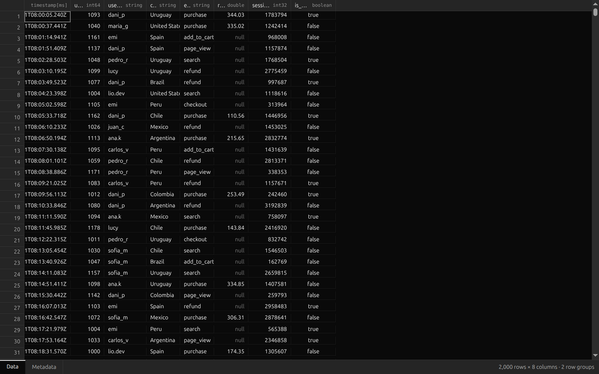

# Parquet Viewer for Orca

Open Apache Parquet files in an Orca editor tab. A virtualized grid over millions of rows, the
file's schema and row groups on a second tab, and Orca's own theme, saving and change tracking.
It only reads: nothing in the file changes. Requires Orca 1.4.248 or later.

## Use it

After installing it from **Settings → Plugins**, open any `.parquet`, `.parq`, `.pq` or `.pqt`
file from the file explorer. To see the raw bytes instead, switch the tab to **Source**.

- **Data:** every visible row and column is drawn on demand, so files with millions of rows and
  thousands of columns scroll smoothly. Column headers stack each column's name above its type
  (`int64`, `string`, `timestamp[us]`, `decimal(18,3)`…), and columns open fitted to their
  headers and first rows. Drag a column's right edge to resize it, or double-click that edge to
  fit it again to the values on screen. Click a column header to sort ascending, click again for
  descending, and a third time to restore the file's own row order; nulls stay last either way.
  Each column also has a filter input under its header: plain text is a case-insensitive
  contains match (use `=100` for an exact number), while numbers and dates accept comparisons
  (`>100`, `<=50`, `=2025-01-01`) and inclusive ranges (`10..20`, `2025-01-01..2025-12-31`).
  Filters combine with each other and with the active sort. Arrow keys, Page Up/Down, Home/End
  and Ctrl+arrows move through the grid; rows read from the file as they come into view.
- **Metadata:** the file's facts — rows, row groups, size, writer and compression — its full
  schema tree with repetition and types, row-group sizes and codecs, and its key-value metadata
  (pandas metadata pretty-printed as JSON).
- **Values:** nulls show dimmed, `NaN` and `Infinity` as themselves, int64 and decimals as
  exact digits, timestamps as UTC, nested lists/structs/maps/JSON as compact JSON, binary as
  hex, GeoParquet geometries as GeoJSON.

The viewer follows your Orca theme and reloads when the file changes on disk.

## Good to know

- **Read-only.** Parquet is a columnar format: appending a row rewrites the whole file. Orca
  saves an editor's file by replacing it whole, so editing here would either corrupt the layout
  or quietly drop everything the writer stored that this viewer does not model. To change data,
  use DuckDB, pyarrow or your pipeline; to peek at it, use this.
- **Codecs:** uncompressed, snappy, gzip, zstd, lz4 and lz4_raw, all decoded in pure JavaScript
  — no WebAssembly, so the editor runs in every Orca client, not just the desktop app. Gzip
  pages with back-to-back members decode too. Files using **brotli or lzo compression** open,
  but those columns show as unavailable, with a notice naming the codec.
- **BSON and INTERVAL columns** cannot be decoded; the rest of their rows still shows.
- **Timestamps show as UTC.** A `TIMESTAMP` written without UTC adjustment is stored as naive
  values; this viewer prints those raw values with a UTC suffix rather than guessing a time
  zone, matching what the file actually says.
- **Decimals** decode as scaled floating point, as hyparquet reads them; very large scales can
  lose precision in the display. INT64 and timestamps never do.
- **Sorting and filtering read the whole file once** and keep the rows in memory; later changes
  reuse them. With the 64 MB file cap, that stays manageable.
- **Filters run in memory.** Nulls only match a text filter such as `null`, not comparisons.
  Dates compare in UTC, and a date-only bound such as `2025-12-31` covers the whole day.
- **Files up to 64 MB.** That is the most Orca hands to a plugin editor.
- **Encrypted files** (parquet modular encryption) are recognised and declined with a note.

## What is in this folder

- `orca-plugin.json`: what Orca loads.
- `editor/index.html`: the built editor, one self-contained file. Generated and committed: never
  edit it by hand.
- `build/`: the source of `editor/`, the build recipe and the tests; see
  [build/README.md](build/README.md).
- `images/`: the catalog cover and screenshots.

## Future work

- **Per-column filter popovers.** The filter row covers quick text and comparison filters. A
  popover opened from each header would add type-aware operators, null controls and between
  inputs without taking an extra row of vertical space.

## Changelog

### 1.0.0

- Read-only viewer: virtualized data grid with type-aware formatting, and a metadata view with
  schema, row groups and key-value metadata.

## License

MIT. See [LICENSE](LICENSE). The editor bundles third-party software listed in
[THIRD_PARTY_NOTICES.txt](THIRD_PARTY_NOTICES.txt).
